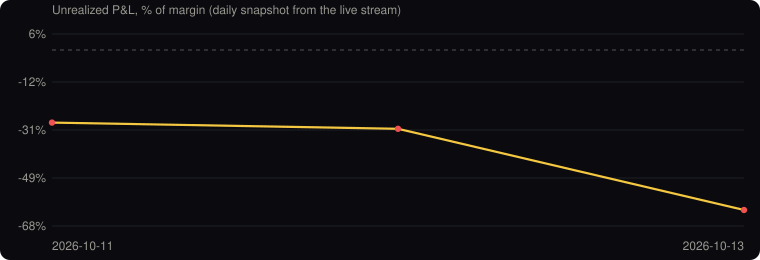

# Live Bot Record: a real DCA bot, one snapshot a day

A [Blitz](https://www.blitz-trading.com/?utm_source=github&utm_medium=repo&utm_campaign=gh_live_record&utm_content=readme_top) DCA ladder bot has been trading a real exchange account since **3 August 2026**, on a [24/7 YouTube live stream](https://www.youtube.com/@Blitztradinglab/live). Once a day we copy what the stream shows into this repository, so anyone can follow the bot over time instead of seeing only the good days.

- **Losing days stay in.** Rows are never edited after the day, except to fix a reading mistake, and every change is visible in the git history.
- **Only what the stream already shows.** Position, prices, unrealized P&L, liquidation price and take-profit count. Wallet balances are never recorded.
- **One account, one bot.** This is a single live example, not a promise of future results.

<!-- RECORD:START -->
**Day 86** · last snapshot 2026-10-27 13:41 KST

| Date (KST) | Day | Position | Step | Avg entry | Price | Unrealized | Liquidation | TPs (7d) | Realized (7d) |
| --- | ---: | --- | ---: | ---: | ---: | ---: | ---: | ---: | ---: |
| 2026-10-27 | 86 | SKHYUSDT long 5x | 9/10 | 164.64 | 145.97 | -907.18 USDT (-56.5%) | 87.02 | 0 | 0.00 USDT |
| 2026-10-26 | 85 | SKHYUSDT long 5x | 9/10 | 164.64 | 140.4 | -1,175.40 USDT (-73.2%) | 87.02 | 0 | 0.00 USDT |
| 2026-10-25 | 84 | SKHYUSDT long 5x | 9/10 | 164.64 | 138.75 | -1,257.03 USDT (-78.3%) | 87.01 | 0 | 0.00 USDT |
| 2026-10-24 | 83 | SKHYUSDT long 5x | — | 164.64 | 137.81 | -1,303.67 USDT (-81.2%) | 87.01 | — | — |
| 2026-10-23 | 82 | SKHYUSDT long 5x | 9/10 | 164.64 | 137.68 | -1,309.51 USDT (-81.5%) | 87.01 | 0 | 0.00 USDT |
| 2026-10-22 | 81 | SKHYUSDT long 5x | 9/10 | 164.64 | 138.12 | -1,288.61 USDT (-80.2%) | 87.01 | 0 | 0.00 USDT |
| 2026-10-21 | 80 | SKHYUSDT long 5x | 9/10 | 164.64 | 145.35 | -935.36 USDT (-58.3%) | 87.02 | 0 | 0.00 USDT |
| 2026-10-20 | 79 | SKHYUSDT long 5x | — | 164.64 | 137.59 | -1,314.36 USDT (-81.9%) | 87.01 | — | — |
| 2026-10-19 | 78 | SKHYUSDT long 5x | 9/10 | 164.64 | 140.5 | -1,171.02 USDT (-72.9%) | 87.02 | 0 | 0.00 USDT |
| 2026-10-18 | 77 | SKHYUSDT long 5x | 9/10 | 164.64 | 134.31 | -1,473.74 USDT (-91.8%) | 87.01 | 0 | 0.00 USDT |
| 2026-10-17 | 76 | SKHYUSDT long 5x | 9/10 | 164.64 | 137.76 | -1,304.65 USDT (-81.2%) | 87.01 | 0 | 0.00 USDT |
| 2026-10-16 | 75 | SKHYUSDT long 5x | 9/10 | 164.64 | 144.48 | -979.58 USDT (-61.0%) | 87.02 | 0 | 0.00 USDT |
| 2026-10-15 | 74 | SKHYUSDT long 5x | 9/10 | 164.64 | 139.13 | -1,239.54 USDT (-77.2%) | 87.02 | 0 | 0.00 USDT |
| 2026-10-14 | 73 | SKHYUSDT long 5x | 8/10 | 173.94 | 155.86 | -582.60 USDT (-51.9%) | 77.81 | 0 | 0.00 USDT |
| 2026-10-13 | 72 | SKHYUSDT long 5x | 8/10 | 173.94 | 152.38 | -694.23 USDT (-61.8%) | 77.95 | 0 | 0.00 USDT |
| 2026-10-12 | 71 | SKHYUSDT long 5x | 7/10 | 180.83 | 169.78 | -237.03 USDT (-30.4%) | 36.11 | 0 | 0.00 USDT |
| 2026-10-11 | 70 | SKHYUSDT long 5x | 7/10 | 180.83 | 170.65 | -218.37 USDT (-28.1%) | 36.11 | 6 | +4.79 USDT |
<!-- RECORD:END -->

Raw data: [`data/daily.csv`](data/daily.csv) · Web view: [blitztrading.github.io/live-bot-record](https://blitztrading.github.io/live-bot-record/)

## How to read it

| Column | Meaning |
| --- | --- |
| Day | Days since the bot went live (3 Aug 2026 = Day 1). |
| Step | How many of the ladder's orders are filled, e.g. `7/10`. A DCA ladder adds to the position as price moves against it. |
| Avg entry | Average entry price of the open position. |
| Unrealized | Open P&L in USDT and as % of margin, as the stream shows it. A DCA bot can sit deep in the red while it waits for a bounce. |
| Liquidation | Estimated liquidation price shown by the exchange. |
| TPs (7d), Realized (7d) | Take-profits closed and realized P&L over the last 7 days, as the stream shows it. |

Want to see how the average entry and liquidation move as a ladder fills? Try the free [DCA Ladder Calculator](https://blitztrading.github.io/dca-ladder-calculator/).

## About Blitz

[Blitz](https://www.blitz-trading.com/?utm_source=github&utm_medium=repo&utm_campaign=gh_live_record&utm_content=readme_about) is a free DCA ladder bot that runs on your own exchange account (Bybit, Gate, KuCoin, Bitget, BingX, Hyperliquid). No subscription; Hyperliquid adds a Blitz builder fee. Your funds stay on your exchange, and Blitz never asks for withdrawal access.

[Run the same kind of bot for free →](https://www.blitz-trading.com/?utm_source=github&utm_medium=repo&utm_campaign=gh_live_record&utm_content=readme_cta)

Backtests and their out-of-sample checks are archived separately in [blitz-backtest-evidence](https://github.com/BlitzTrading/blitz-backtest-evidence).

Trading involves risk of loss, including your whole margin. Nothing here is financial advice.

## Follow Blitz

- YouTube: [24/7 live bot](https://www.youtube.com/@Blitztradinglab/live) · [Blitz Crypto Lab](https://www.youtube.com/@BlitzCryptoLab)
- Telegram: [Official](https://t.me/Official_Blitz_Trading_bot) · [Live updates](https://t.me/BlitzTradingLive)
- X: [@Blitz_trade_bot](https://x.com/Blitz_trade_bot) · [@Blitz_Market_Up](https://x.com/Blitz_Market_Up)
- Threads: [@blitztradebot](https://www.threads.com/@blitztradebot) · [@blitz_partner](https://www.threads.com/@blitz_partner)
- Instagram: [@blitz_news_26](https://www.instagram.com/blitz_news_26/)

## License

Data in `data/` is released under [CC BY 4.0](https://creativecommons.org/licenses/by/4.0/). Scripts are MIT.
