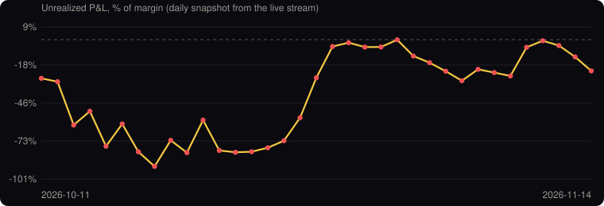

# Live Bot Record: real DCA bots, one snapshot a day

Two [Blitz](https://www.blitz-trading.com/?utm_source=github&utm_medium=repo&utm_campaign=gh_live_record&utm_content=readme_top) DCA ladder bots trade real exchange accounts, each on its own 24/7 YouTube live stream. Once a day we copy what the bot's screen shows into this repository, so anyone can follow the bots over time instead of seeing only the good days.

- **SKHY bot**: live since **3 August 2026**, on the [English 24/7 stream](https://www.youtube.com/@BlitzTradingLive/live).
- **BTC bot**: live since **6 November 2026** on a separate account, on the [Spanish 24/7 stream](https://www.youtube.com/@BlitzCriptoES/live).

- **Losing days stay in.** Rows are never edited after the day, except to fix a reading mistake, and every change is visible in the git history.
- **Only what the screen already shows.** Position, prices, P&L, liquidation price and take-profit counts. Wallet balances are never recorded.
- **One account per bot.** These are live examples, not a promise of future results.

## SKHY bot (English stream)

<!-- RECORD:START -->
**Day 104** · last snapshot 2026-11-14 13:41 KST

| Date (KST) | Day | Position | Step | Avg entry | Price | Unrealized | Liquidation | TPs (7d) | Realized (7d) |
| --- | ---: | --- | ---: | ---: | ---: | ---: | ---: | ---: | ---: |
| 2026-11-14 | 104 | SKHYUSDT long 5x | 6/10 | 136.02 | 129.86 | -120.58 USDT (-22.6%) | — | 79 | +71.25 USDT |
| 2026-11-13 | 103 | SKHYUSDT long 5x | 5/10 | 138.57 | 135.07 | -44.69 USDT (-12.5%) | — | 79 | +71.25 USDT |
| 2026-11-12 | 102 | SKHYUSDT long 5x | 3/10 | 140.46 | 139.21 | -6.17 USDT (-4.3%) | — | 56 | +53.74 USDT |
| 2026-11-11 | 101 | SKHYUSDT long 5x | 1/10 | 139.95 | 139.73 | -0.27 USDT (-0.8%) | — | 36 | +40.26 USDT |
| 2026-11-10 | 100 | SKHYUSDT long 5x | 3/10 | 134.64 | 133.1 | -7.91 USDT (-5.6%) | — | 26 | +38.42 USDT |
| 2026-11-09 | 99 | SKHYUSDT long 5x | 8/10 | 135.18 | 128.07 | -295.67 USDT (-26.3%) | 40.66 | 29 | +29.25 USDT |
| 2026-11-08 | 98 | SKHYUSDT long 5x | 8/10 | 135.18 | 128.72 | -268.34 USDT (-23.9%) | 40.69 | 53 | +45.60 USDT |
| 2026-11-07 | 97 | SKHYUSDT long 5x | 8/10 | 135.18 | 129.35 | -241.43 USDT (-21.5%) | 40.69 | 62 | +58.41 USDT |
| 2026-11-06 | 96 | SKHYUSDT long 5x | 8/10 | 135.18 | 127.02 | -334.60 USDT (-29.8%) | 40.69 | 62 | +58.41 USDT |
| 2026-11-05 | 95 | SKHYUSDT long 5x | 6/10 | 144.4 | 137.73 | -122.11 USDT (-22.9%) | — | 62 | +58.41 USDT |
| 2026-11-04 | 94 | SKHYUSDT long 5x | — | 147.53 | 142.57 | -88.92 USDT (-16.7%) | — | — | — |
| 2026-11-03 | 93 | SKHYUSDT long 5x | — | 151.62 | 147.94 | -42.39 USDT (-11.9%) | — | — | — |
| 2026-11-02 | 92 | SKHYUSDT long 5x | 1/10 | 158.11 | 158.05 | -0.05 USDT (-0.1%) | — | 58 | +73.14 USDT |
| 2026-11-01 | 91 | SKHYUSDT long 5x | 6/10 | 152.13 | 150.51 | -28.45 USDT (-5.3%) | — | 29 | +48.57 USDT |
| 2026-10-31 | 90 | SKHYUSDT long 5x | 6/10 | 152.13 | 150.5 | -28.80 USDT (-5.4%) | — | 29 | +48.57 USDT |
| 2026-10-30 | 89 | SKHYUSDT long 5x | 5/10 | 154.98 | 154.3 | -7.93 USDT (-2.2%) | — | 29 | +48.57 USDT |
| 2026-10-29 | 88 | SKHYUSDT long 5x | 4/10 | 163.02 | 161.35 | -11.53 USDT (-5.0%) | — | 10 | +28.16 USDT |
| 2026-10-28 | 87 | SKHYUSDT long 5x | 9/10 | 164.64 | 155.44 | -444.12 USDT (-27.7%) | 87.03 | 0 | 0.00 USDT |
| 2026-10-27 | 86 | SKHYUSDT long 5x | 9/10 | 164.64 | 145.97 | -907.18 USDT (-56.5%) | 87.02 | 0 | 0.00 USDT |
| 2026-10-26 | 85 | SKHYUSDT long 5x | 9/10 | 164.64 | 140.4 | -1,175.40 USDT (-73.2%) | 87.02 | 0 | 0.00 USDT |
| 2026-10-25 | 84 | SKHYUSDT long 5x | 9/10 | 164.64 | 138.75 | -1,257.03 USDT (-78.3%) | 87.01 | 0 | 0.00 USDT |
| 2026-10-24 | 83 | SKHYUSDT long 5x | — | 164.64 | 137.81 | -1,303.67 USDT (-81.2%) | 87.01 | — | — |
| 2026-10-23 | 82 | SKHYUSDT long 5x | 9/10 | 164.64 | 137.68 | -1,309.51 USDT (-81.5%) | 87.01 | 0 | 0.00 USDT |
| 2026-10-22 | 81 | SKHYUSDT long 5x | 9/10 | 164.64 | 138.12 | -1,288.61 USDT (-80.2%) | 87.01 | 0 | 0.00 USDT |
| 2026-10-21 | 80 | SKHYUSDT long 5x | 9/10 | 164.64 | 145.35 | -935.36 USDT (-58.3%) | 87.02 | 0 | 0.00 USDT |
| 2026-10-20 | 79 | SKHYUSDT long 5x | — | 164.64 | 137.59 | -1,314.36 USDT (-81.9%) | 87.01 | — | — |
| 2026-10-19 | 78 | SKHYUSDT long 5x | 9/10 | 164.64 | 140.5 | -1,171.02 USDT (-72.9%) | 87.02 | 0 | 0.00 USDT |
| 2026-10-18 | 77 | SKHYUSDT long 5x | 9/10 | 164.64 | 134.31 | -1,473.74 USDT (-91.8%) | 87.01 | 0 | 0.00 USDT |
| 2026-10-17 | 76 | SKHYUSDT long 5x | 9/10 | 164.64 | 137.76 | -1,304.65 USDT (-81.2%) | 87.01 | 0 | 0.00 USDT |
| 2026-10-16 | 75 | SKHYUSDT long 5x | 9/10 | 164.64 | 144.48 | -979.58 USDT (-61.0%) | 87.02 | 0 | 0.00 USDT |
| 2026-10-15 | 74 | SKHYUSDT long 5x | 9/10 | 164.64 | 139.13 | -1,239.54 USDT (-77.2%) | 87.02 | 0 | 0.00 USDT |
| 2026-10-14 | 73 | SKHYUSDT long 5x | 8/10 | 173.94 | 155.86 | -582.60 USDT (-51.9%) | 77.81 | 0 | 0.00 USDT |
| 2026-10-13 | 72 | SKHYUSDT long 5x | 8/10 | 173.94 | 152.38 | -694.23 USDT (-61.8%) | 77.95 | 0 | 0.00 USDT |
| 2026-10-12 | 71 | SKHYUSDT long 5x | 7/10 | 180.83 | 169.78 | -237.03 USDT (-30.4%) | 36.11 | 0 | 0.00 USDT |
| 2026-10-11 | 70 | SKHYUSDT long 5x | 7/10 | 180.83 | 170.65 | -218.37 USDT (-28.1%) | 36.11 | 6 | +4.79 USDT |
<!-- RECORD:END -->

## BTC bot (Spanish stream)

BTCUSDT 5x long, 18-step ladder, +1.5% take-profit, no stop-loss. Read once a day from the bot's Blitz dashboard, the same screen the [Spanish 24/7 stream](https://www.youtube.com/@BlitzCriptoES/live) shows (the stream started on 10 Nov 2026; earlier rows were read from the dashboard directly). Counts and realized P&L are all-time since Day 1.

<!-- BTC:START -->
**Day 9** · last snapshot 2026-11-14 13:42 KST

| Date (KST) | Day | Position | Step | Avg entry | Size (BTC) | Cycles closed | TPs | SLs | Realized (all time) |
| --- | ---: | --- | ---: | ---: | ---: | ---: | ---: | ---: | ---: |
| 2026-11-14 | 9 | BTCUSDT long 5x | 12/18 | 72,619.19 | 0.0138 | 5 | 5 | 0 | +0.90 USDT |
| 2026-11-13 | 8 | BTCUSDT long 5x | 11/18 | 73,882.78 | 0.0108 | 5 | 5 | 0 | +0.90 USDT |
| 2026-11-12 | 7 | BTCUSDT long 5x | 8/18 | 75,683.25 | 0.0068 | 5 | 5 | 0 | +0.90 USDT |
| 2026-11-11 | 6 | BTCUSDT long 5x | 8/18 | 75,683.25 | 0.0068 | 5 | 5 | 0 | +0.90 USDT |
| 2026-11-10 | 5 | BTCUSDT long 5x | 8/18 | 75,683.25 | 0.0068 | 5 | 5 | 0 | +0.90 USDT |
| 2026-11-09 | 4 | BTCUSDT long 5x | 8/18 | 75,683.25 | 0.0068 | 5 | 5 | 0 | +0.90 USDT |
| 2026-11-08 | 3 | BTCUSDT long 5x | 6/18 | 76,113.6 | 0.0054 | 5 | 5 | 0 | +0.90 USDT |
| 2026-11-07 | 2 | BTCUSDT long 5x | 6/18 | 76,113.6 | 0.0054 | 5 | 5 | 0 | +0.90 USDT |
| 2026-11-06 | 1 | BTCUSDT long 5x | 5/18 | 76,291.4 | 0.0047 | 5 | 5 | 0 | +0.90 USDT |
<!-- BTC:END -->

Raw data: [`data/daily.csv`](data/daily.csv) (SKHY) · [`data/btc-daily.csv`](data/btc-daily.csv) (BTC) · Web view: [blitztrading.github.io/live-bot-record](https://blitztrading.github.io/live-bot-record/)

## How to read it

| Column | Meaning |
| --- | --- |
| Day | Days since the bot went live (SKHY: 3 Aug 2026 = Day 1, BTC: 6 Nov 2026 = Day 1). |
| Step | How many of the ladder's orders are filled, e.g. `7/10`. A DCA ladder adds to the position as price moves against it. |
| Avg entry | Average entry price of the open position. |
| Unrealized | Open P&L in USDT and as % of margin, as the stream shows it. A DCA bot can sit deep in the red while it waits for a bounce. |
| Liquidation | Estimated liquidation price shown by the exchange. |
| TPs (7d), Realized (7d) | SKHY: take-profits closed and realized P&L over the last 7 days, as the stream shows it. |
| Size (BTC) | BTC: size of the open position. |
| Cycles closed, TPs, SLs, Realized (all time) | BTC: ladder cycles closed since Day 1, how many ended at take-profit or stop-loss, and the realized P&L. |

Want to see how the average entry and liquidation move as a ladder fills? Try the free [DCA Ladder Calculator](https://blitztrading.github.io/dca-ladder-calculator/).

## About Blitz

[Blitz](https://www.blitz-trading.com/?utm_source=github&utm_medium=repo&utm_campaign=gh_live_record&utm_content=readme_about) is a free DCA ladder bot that runs on your own exchange account (Bybit, Gate, KuCoin, Bitget, BingX, Hyperliquid). No subscription; Hyperliquid adds a Blitz builder fee. Your funds stay on your exchange, and Blitz never asks for withdrawal access.

[Run the same kind of bot for free →](https://www.blitz-trading.com/?utm_source=github&utm_medium=repo&utm_campaign=gh_live_record&utm_content=readme_cta)

Backtests and their out-of-sample checks are archived separately in [blitz-backtest-evidence](https://github.com/BlitzTrading/blitz-backtest-evidence).

Trading involves risk of loss, including your whole margin. Nothing here is financial advice.

## Follow Blitz

- YouTube: [24/7 live bot (English)](https://www.youtube.com/@BlitzTradingLive/live) · [24/7 live bot (Spanish)](https://www.youtube.com/@BlitzCriptoES/live) · [Blitz Crypto Lab](https://www.youtube.com/@BlitzCryptoLab)
- Telegram: [Official](https://t.me/Official_Blitz_Trading_bot) · [Live updates](https://t.me/BlitzTradingLive)
- X: [@Blitz_trade_bot](https://x.com/Blitz_trade_bot) · [@Blitz_Market_Up](https://x.com/Blitz_Market_Up)
- Threads: [@blitztradebot](https://www.threads.com/@blitztradebot) · [@blitz_partner](https://www.threads.com/@blitz_partner)
- Instagram: [@blitz_news_26](https://www.instagram.com/blitz_news_26/)

## License

Data in `data/` is released under [CC BY 4.0](https://creativecommons.org/licenses/by/4.0/). Scripts are MIT.
